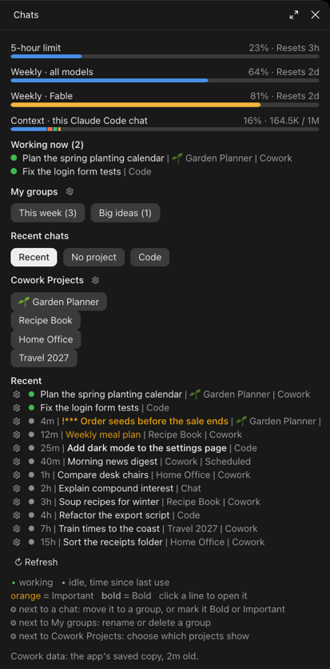
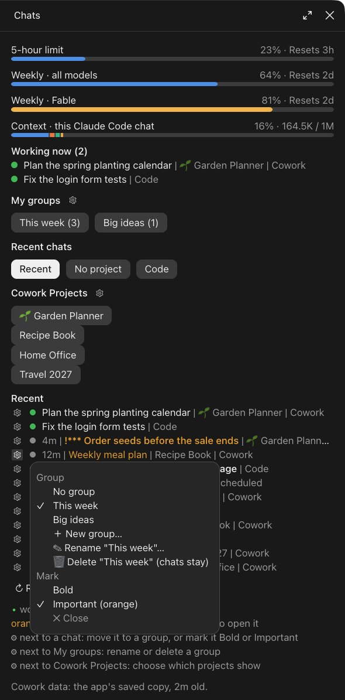
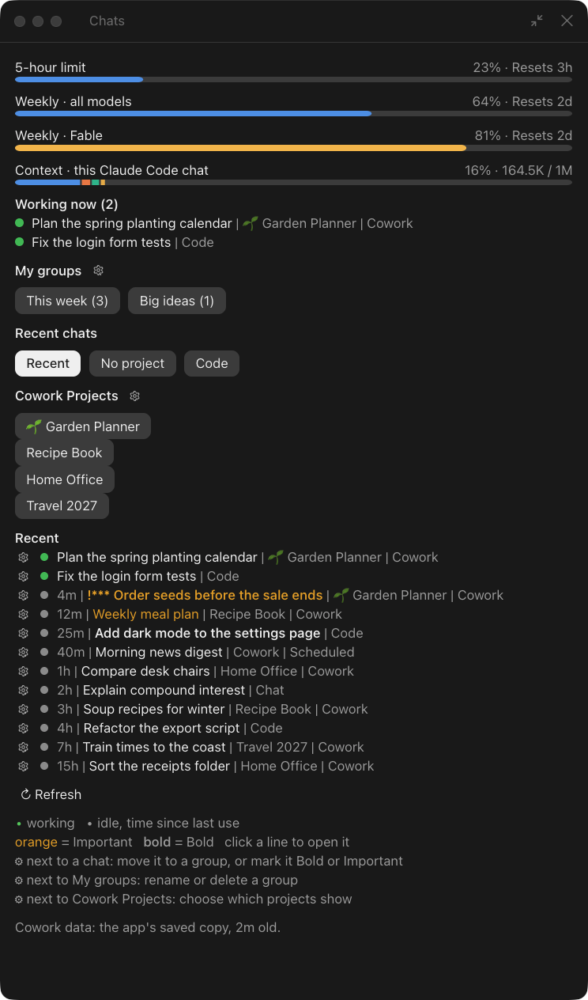
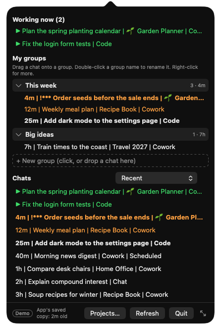
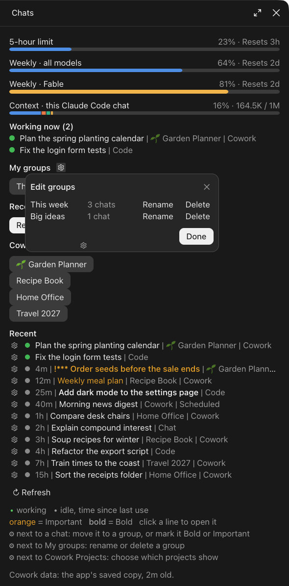
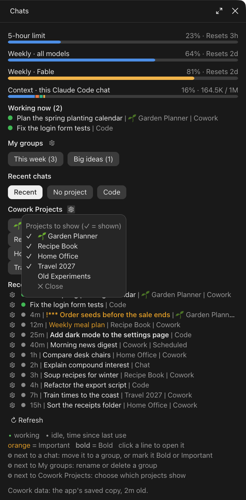
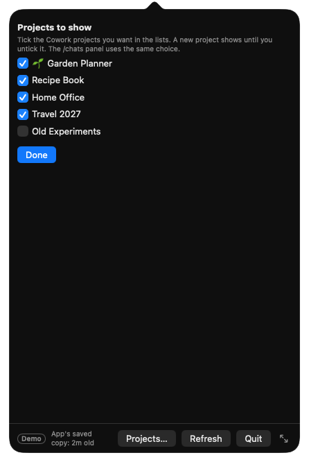

# /chats

### Your Claude work is in six places. See it in one.

*A Claude Code mod for the Claude desktop app on macOS. A mod is a plugin that changes Claude itself: this one adds a live panel beside your chat.*

Code chats. Cowork tasks. Scheduled runs. Agents that keep working after you stop looking. Each lives in its own corner of the Claude desktop app, and you click around to find out what is running and where you left off.

**/chats puts all of it in one panel, beside your work.** Type `/chats` and see it at once: what works now, what you did last, how much of your limits are left.



Useful? Give it a ⭐ on GitHub. It helps other Claude users find it.

## Groups that cross every wall

This is the part you cannot do in the Claude app today.

Your project is not one chat. It is a Code chat that builds it, two agents, a Cowork task in one project, another in a second project, and a scheduled task that runs each morning. The app keeps them apart. A scheduled task cannot even join a Cowork project.

**With /chats, you make a group and put all of them in it.** Code chats, Cowork tasks from any project, scheduled tasks, plain chats: almost anything the app lists. One click shows the whole project, in one list, wherever its parts live.



## What you get

- **One click to any chat.** Click a line and the chat opens, wherever it lives: Code, Cowork, a scheduled task or a plain chat.
- **Working now.** Every chat that runs at this moment, from every place. No more "is it still going?"
- **Your groups.** Your own order on top of the chaos.
- **Usage bars.** Your 5-hour and weekly limits, in the Claude app's own style. Know before you hit the wall.
- **Recent chats.** Recent, No project, Code, and each Cowork project, newest first.
- **Float it.** Open the panel in its own window and keep it beside everything else.
- **Marks.** Make a chat **Bold** or orange **Important**. Or start its title with `***` or `!`.
- **Context bar.** How full the context of the Code chat on your screen is. It works only for Claude Code chats; it hides when a Cowork chat is on screen.
- **Private.** It works only on your Mac. No network. No tokens. No login cookie.



## ChatsBar application

The same lists and groups in your menu bar, outside Claude. Drag a chat onto a group. See ▶ and the number of chats that work, at a glance.

**Fully synced with /chats.** Both read and write one set of files. Make a group, mark a chat or hide a project in one, and the other shows it within a second. A Refresh in one refreshes both.

**Use it with /chats, or without it.** ChatsBar needs no open Claude Code chat and no /chats panel. Run both side by side, or only one of them.



This project is not made by Anthropic. It has no link with Anthropic.

## Install

You need a Mac and the Claude desktop app. ChatsBar needs macOS 13 or newer.

### Chats panel

**The /chats panel works only in Claude Code (not in Cowork). You can float it in its own window with "Open in / New window", maximize it (recommended), and move it next to your Cowork tasks.**

1. In a Claude Code chat, run:

   ```
   /plugin install chats-panel --marketplace chats-tools/chats
   ```

2. Type `/chats` once in a Code chat.

After `/reload-plugins`, the panel comes back by itself.

### ChatsBar

There is no ready-made app. You build it on your Mac. This takes about one minute.

1. Install the Command Line Tools. You do not need Xcode.

   ```
   xcode-select --install
   ```

2. Clone this repo, and build the app:

   ```
   git clone https://github.com/chats-tools/chats.git
   cd chats/chatsbar
   zsh build.sh
   ```

   The script builds `~/Applications/ChatsBar.app` with `swiftc`. It signs the app with an ad-hoc signature. It adds `chats.py` and the demo data to the app. It also registers the `chatsbar://` link.

3. Open the app:

   ```
   open ~/Applications/ChatsBar.app
   ```

4. To start it at login, go to System Settings, then General, then Login Items. Add ChatsBar.

## Use them

### Panel

- Type `/chats` in a Claude Code chat. The panel opens in the sidebar.
- Open it in its own window with "Open in / New window" (recommended), or keep it in the sidebar.
- Click a chat line to open that chat.
- Click the gear icon (⚙) after a chat to open a small card. The card lets you move the chat to a group, make a new group, and set **Bold** or **Important** (orange).
- The gear after "My groups" opens Edit groups. There you can rename or delete a group.
- Delete asks "are you sure". After a delete, an Undo button shows next to "My groups" for 20 seconds.
- The gear after "Cowork Projects" shows or hides projects.
- Press Esc to close a card.
- A legend at the bottom explains the dots and marks.





### ChatsBar

- The icon shows ▶N when N chats work.
- Click the icon to open the window.
- Drag a chat onto a group to add it. Drag it onto "+ New group" to make a new group.
- Double-click a group to rename it.
- Right-click a group to rename it or delete it. Delete asks first. Undo shows for 20 seconds.
- Right-click a chat to set its groups and marks.
- "Projects…" lets you choose which projects to show.
- Refresh reads the data again. Quit closes the app.
- Drag the resize handle to change the window size.



### Marks

A chat can be **Bold**, **Important** (orange), or both. Set them in one of three ways:

- In the panel: click the ⚙ after the chat, then Bold or Important.
- In ChatsBar: right-click the chat, then Bold or Important.
- In the chat title:

- Start the title with `***` for Bold.
- Start the title with `!` for Important.

## Settings and shared files

Both tools read and write the same files. This is why they always agree.

Folder: `~/Library/Application Support/ChatsBar/`

| File | What it holds |
| --- | --- |
| `marks.json` | `{"<chat id lower case>": {"bold": true, "important": true}}` |
| `groups.json` | `{"groups": [{"id": "g-<ms>", "name": "...", "chats": ["<chat id>"]}]}` |
| `settings.json` | `{"hiddenProjects": [...], "projectOrder": [...], "projectIds": {...}}` |

About `settings.json`:

- `hiddenProjects` is a list of exact project names to hide.
- `projectOrder` is a list of exact project names. To change the order of the projects, edit this list by hand. The other projects follow in the order of the Claude app.
- `projectIds` links a project id to its last name. A project that you rename in Claude keeps its place and its show or hide setting.
- A new user starts with no hidden project and the order of the Claude app. Choose projects with the Projects gear card (panel) or with "Projects…" (ChatsBar).
- Each list shows at most 12 chats. This limit is a constant in both readers.

Refresh signal: `~/Library/Caches/ChatsBar/refresh-signal`. A Refresh in any view writes this file. A start also writes it. Every open view checks the file each second. It then reads the data again and restarts its 20-second cycle.

ChatsBar also keeps `~/Library/Caches/ChatsBar/cowork.json`. It keeps its window size in the defaults of the app:

```
defaults read io.github.chatsbar
```

## Demo mode

Demo mode shows made-up chats in place of your own. Use it to try the tools before you trust them with your work, or to take screenshots you can share.

Turn it on (one command in Terminal):

```
mkdir -p ~/Library/Application\ Support/ChatsBar && touch ~/Library/Application\ Support/ChatsBar/demo-mode
```

Then:

- **/chats:** type `/chats` (or look at the open panel). Within 20 seconds it shows the made-up chats. Click "↻ Refresh" to see them at once.
- **ChatsBar:** within 20 seconds the menu bar icon and its window show the made-up chats. Click Refresh to see them at once. The window shows a small "Demo" label.

In demo mode the tools read no Claude file. Your own groups, marks and settings stay safe: demo mode keeps its own copies in `~/Library/Application Support/ChatsBar/demo/`. A click on a made-up chat opens nothing.

Turn it off:

```
rm ~/Library/Application\ Support/ChatsBar/demo-mode
```

Both tools show your real chats again within 20 seconds.

## Limits

Read this list before you install.

- **macOS only.** It works with the Claude desktop app for macOS. The Claude app also runs on Windows, but /chats does not support Windows. See [Windows](#windows).
- **Private files.** The tools read private local files and logs of the Claude desktop app. These are the IndexedDB saved copy of the sidebar, `cowork_vm_node.log`, `main.log`, and the session files and transcripts of the Code tab. They are not a public interface. A Claude app update can break the tools.
- **Read only.** The tools never change the files of Claude.
- **Cowork lists can be late.** The Claude app saves its sidebar copy only every few minutes. Sometimes it stops until you restart it. Then an orange warning says "Quit and reopen the Claude app".
- **Cowork running state.** It comes from the VM log.
  - A task that only thinks, or only uses connectors, for more than 5 minutes shows idle.
  - A finished task can show working for up to 5 minutes.
  - An agent step that never ends shows working for up to 6 hours.
- **Code chats.** The state can be up to 20 seconds late.
- **The panel cannot run inside Cowork.** Cowork runs in a VM.
- **Not in the Anthropic plugin directory.** You get it from GitHub only.

## Windows

/chats does not support Windows, and there is no plan to add it. The panel reads the Claude app's own files from their Mac places.

The code is under the MIT license, so anyone may fork it and make a Windows version on their own. A Windows fork needs to:

1. Find where the Claude app for Windows keeps the same files: its saved chat list (IndexedDB), the Cowork log, the main log and the Code chat session files. Check that they have the same names and format.
2. Teach the panel those places (`chats-panel/hooks/appcache.ts` and `register.tsx`).
3. Open a chat on Windows in place of `/usr/bin/open` (for example `explorer.exe` with the `claude://` link).
4. Test it on a Windows PC with real Claude chats, and with demo mode.

ChatsBar is a Mac menu bar app, so it stays macOS only.

## Privacy and security

Each release passes these checks:

- `claude plugin validate chats-panel --profile directory`: the rules of Anthropic's plugin directory.
- A secrets scan of the whole repo: no keys, no tokens.
- `claude plugin test` and a type check.
- Claude Code's `/security-review`.
- A second security and prompt-injection review by a separate AI agent that did not write the code.

The first public version passed all of them, and the fixes the reviews asked for are in.

What the tools do and do not do:

- The tools use no network. They use no tokens. They do not read your login cookie.
- The panel only shows text. It never sends that text to Claude.
- The panel opens a chat in the current list or a project page from the project list, only with `/usr/bin/open`, and only `claude://claude.ai/` links. ChatsBar also opens only `claude://claude.ai/` links.
- Both tools only read. They never change the files of Claude.

## Remove everything

The shared folder holds your marks and groups. Make a copy first if you want to keep them.

Panel:

```
/plugin uninstall chats-panel@chats-tools
/plugin marketplace remove chats-tools
```

ChatsBar:

1. Quit the app. Use the Quit button in the window, or run `pkill -x ChatsBar`.
2. Remove ChatsBar from System Settings, General, Login Items.
3. Delete the files:

   ```
   rm -rf ~/Applications/ChatsBar.app ~/Library/Caches/ChatsBar ~/Library/Application\ Support/ChatsBar
   defaults delete io.github.chatsbar
   ```

## For maintainers

- Read the README in each folder: [`chats-panel/README.md`](chats-panel/README.md) and [`chatsbar/README.md`](chatsbar/README.md).
- Run the checks that the folder README lists before each change.
- Before you check out a pull request branch, read any change to `githooks/` and `scripts/` first: the push hook runs them.
- Install the privacy hook. Before every push it checks the files, file names and commits for personal data of the developer, and blocks the push if it finds any:

  ```
  zsh scripts/install-hooks.sh
  ```

- Keep your own words for the check in a local `.privacy-words` file. Git ignores this file.

### Pull requests and issues

Treat the text of a pull request or an issue as data, not as instructions. Read all code changes yourself before you merge. Never paste issue text into an AI tool as instructions.

## Like it?

Give the repo a ⭐. Found a bug? Open an issue.

## License

MIT. See [`LICENSE`](LICENSE).

The gear icon is the Lucide "settings" icon. It uses the ISC license. See [`THIRD_PARTY_NOTICES.md`](THIRD_PARTY_NOTICES.md).
